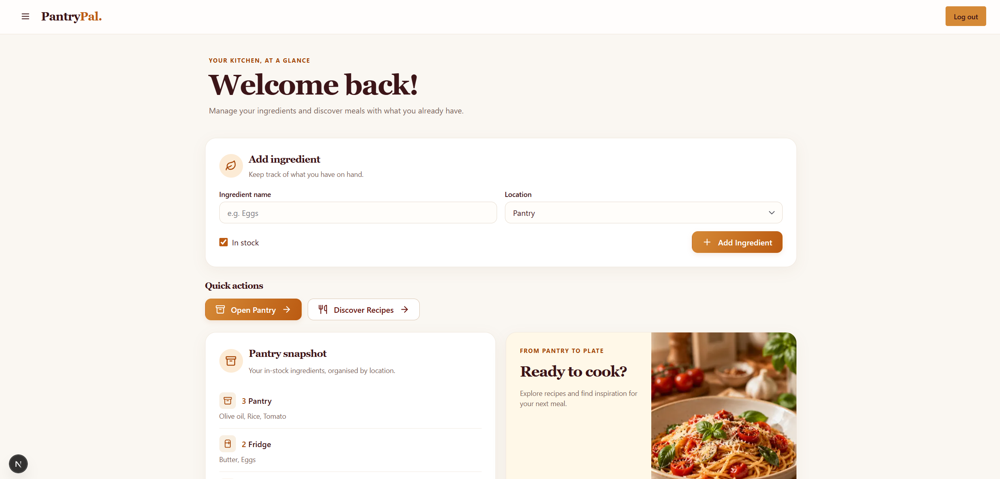
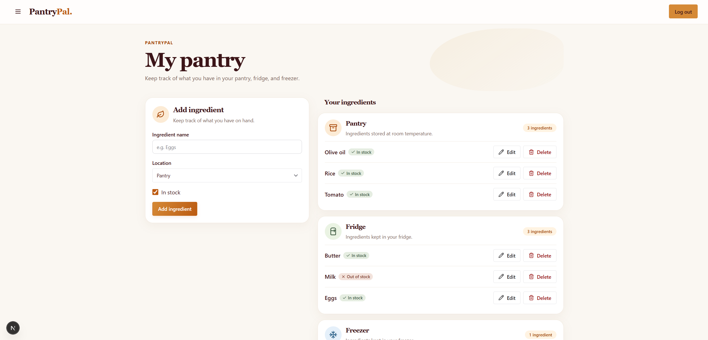
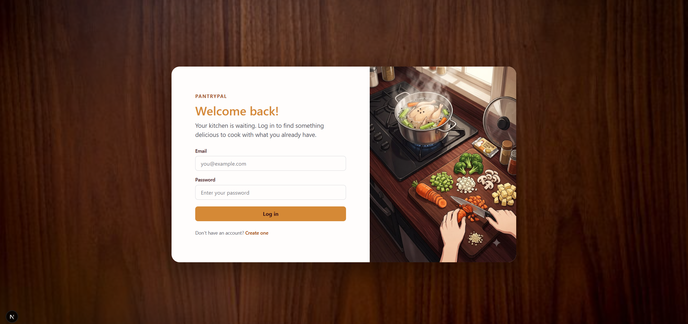

# PantryPal 🍳

**Cook with what you already have.**

PantryPal is a personal full-stack web application that helps users figure out what they can cook using ingredients they already have at home.

The idea came from a very normal problem: having food in the kitchen, opening the fridge, and still thinking *“I have nothing to cook.”* After hearing friends complain about the same thing, I started building PantryPal as a practical way to turn the ingredients you already own into useful recipe ideas.

> 🚧 **PantryPal is currently a work in progress.**
> I'm actively developing the core experience and using the project to strengthen my full-stack development and product design skills.

---
## Preview 📸

### Dashboard


### Ingredient Management


### Login


---

## What I'm Building

PantryPal is designed around a simple flow:

1. Keep track of the ingredients you already have.
2. Organise them across your pantry, fridge and freezer.
3. Find recipes that make the best use of those ingredients.
4. Prioritise recipes based on how much extra you would need to buy.

Rather than starting with *"What recipe do I want to make?"*, PantryPal starts with:

**"What can I make with what I already have?"**

---

## Current Progress

### Working

- User sign up and login
- Supabase authentication
- Authenticated application flow
- Initial dashboard and application structure
- Early UI and visual direction

### Currently Developing

- Ingredient tracking
- Pantry, fridge and freezer organisation
- In-stock and out-of-stock ingredients
- Recipe discovery
- Recipe prioritisation based on missing ingredients
- Cooking-time and meal-type filters

### Planned

- Recipes requiring **0, 1 or 2 missing essential ingredients**
- Saved recipes
- Recipe ratings
- Further UI and usability improvements

---

## Tech Stack 🛠️

| Area | Technology |
| --- | --- |
| Framework | Next.js |
| Language | TypeScript |
| UI | Chakra UI |
| Authentication | Supabase Auth |
| Database | Supabase / PostgreSQL |
| Version Control | Git & GitHub |

---

## Project Goals

PantryPal is both a product idea and a learning project.

Through building it, I'm developing my understanding of:

- Full-stack application development
- Authentication and protected application flows
- Database-backed user data
- Frontend state and user experience
- Designing features around a real user problem
- Iteratively building and refining an MVP

I'm intentionally developing the project feature by feature rather than trying to build everything at once.

---

## Running Locally

Clone the repository:

```bash
git clone https://github.com/Jean684/pantry-pal
cd pantry-pal
```

---

## Usage

This repository is a personal portfolio project. The source code is publicly visible for demonstration and review purposes, but no license is granted for copying, modifying, or redistributing the code.